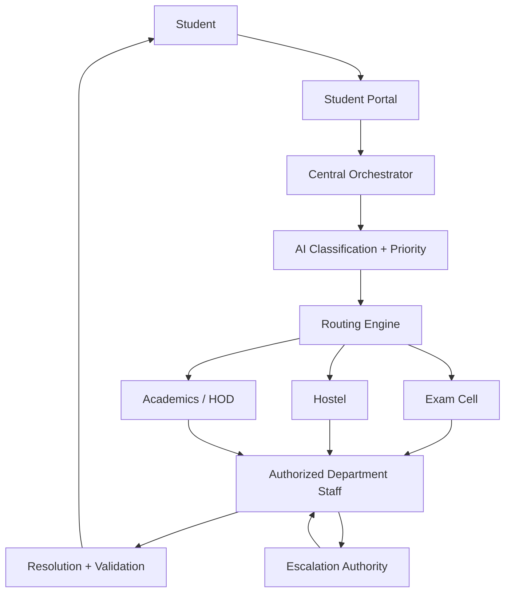

# Actors, Roles and Institutional Hierarchy

## 1. Logical hierarchy

The exact institutional hierarchy must be configurable, but the platform should support this logical chain:



## 2. Student

Can:

- create a complaint;
- attach supporting evidence;
- view previous and pending complaints;
- track status;
- receive notifications;
- respond to clarification requests;
- validate a resolution;
- request reopening where policy allows.

Cannot:

- view other students' complaints;
- modify audit history;
- change priority manually.

## 3. Department Staff

Can:

- view complaints in authorized queues;
- inspect AI classification and confidence;
- accept or reassign within authorized scope;
- request clarification;
- update progress;
- resolve complaints;
- record resolution evidence.

## 4. Department Head / Authorized Authority

Can:

- supervise department queues;
- override routing or priority with reason;
- handle escalated cases;
- approve certain resolution types;
- monitor SLA performance.

## 5. Central Grievance Administrator

Can:

- configure departments;
- define categories;
- define SLA policies;
- manage escalation rules;
- audit system activity;
- review cross-department cases;
- access institutional analytics subject to policy.

## 6. System Administrator

Responsible for infrastructure, identity integration, configuration deployment, and operational monitoring. Should not automatically receive unrestricted access to complaint content.

## 7. Permission model

Use RBAC plus scope:

- role = what actions are allowed;
- department_scope = which queue/data can be accessed;
- case_scope = optional restrictions for sensitive complaints.

Example:

```text
DepartmentStaff + Hostel → Hostel queue only
HODAcademics → Academics queue + escalated cases
CentralAdmin → cross-department operational visibility
Student → own complaints only
```
