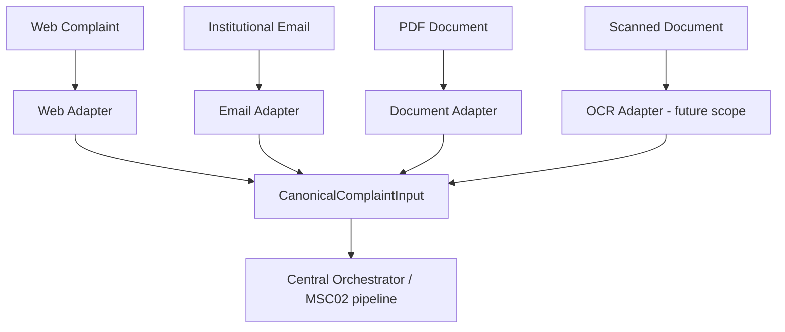
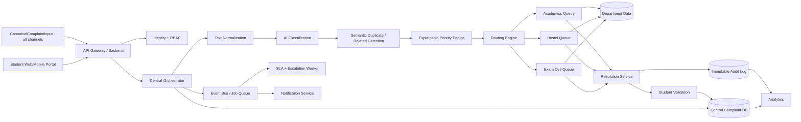

# End-to-End System Architecture

## 0. Multi-channel intake layer (SMA03 capability)

Before anything reaches the MSC02 prioritization pipeline, all input channels converge into one canonical object. This is the architectural join point between the two problem statements.



`CanonicalComplaintInput` fields: `source`, `raw_content`, `extracted_text`, `attachments`, `sender/student identity`, `timestamp`, `detected_language`, `extracted_entities`. Every adapter's only job is to produce this object — nothing downstream needs to know which channel a complaint arrived through.

For the hackathon MVP: Web adapter is live; Email adapter is a simulated adapter (seeded payload run through the same canonicalization path); PDF adapter is live if time allows; OCR adapter is future scope. See `PS_COVERAGE_GAP_ANALYSIS.md` for the authoritative status.

## 1. High-level architecture



## 2. Recommended architectural pattern

Use a modular monolith for the hackathon unless the team already has strong microservice expertise.

Recommended modules:

```text
backend/
  auth/
  complaints/
  ai/
  routing/
  departments/
  sla/
  notifications/
  validation/
  analytics/
  audit/
```

The modules can later be separated into services when scale justifies it.

## 3. Data ownership

### Central Complaint Registry

The source of truth for:

- complaint ID;
- student ID;
- canonical complaint text;
- category;
- priority;
- lifecycle state;
- current department;
- SLA;
- timestamps;
- resolution status.

### Department Queue

Contains active work items needed by a department:

- complaint ID;
- queue status;
- assignment;
- department-specific metadata;
- action timestamps.

It is a projection/work queue, not the only copy of the complaint.

### Audit Store

Append-only record of important actions.

### Archive

Stores completed cases according to institutional retention rules.

## 4. Why not delete from the central system?

When a department finishes a case:

1. remove it from the active departmental queue;
2. keep the central complaint record;
3. write a resolution event;
4. keep audit history;
5. move it to an archived/closed state;
6. expose it in the student's historical complaint view according to policy.

This fixes the logical contradiction in the original diagrams.
