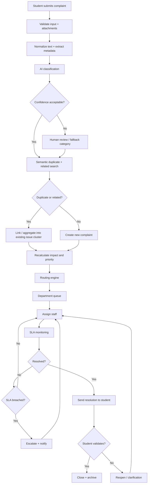

# End-to-End Complaint Flow

## 1. Corrected flow

The corrected order is:

**Submit → Normalize → Classify → Detect duplicate/related complaints → Calculate priority → Route → Assign → Work → SLA monitor → Resolve → Student validation → Archive**

## 2. Duplicate versus related

Do not force everything into a binary duplicate decision.

Use:

- `DUPLICATE`: essentially the same issue, same context.
- `RELATED`: same underlying issue but different incident/context.
- `NEW`: no meaningful match.

Example:

> "Hostel Block A water supply has been unavailable since morning."

and

> "There is no water in Hostel Block A since 8 AM."

Likely duplicate/related cluster.

But:

> "Hostel Block B water supply failed."

is related at a campus infrastructure level but may be a separate case.

## 3. Aggregation behavior

If multiple complaints describe the same systemic issue:

- preserve each student's original complaint;
- create/maintain an issue cluster;
- increase affected-student count;
- increase impact signal;
- prioritize the cluster;
- allow departments to communicate a common update;
- retain individual student visibility.

Never erase individual complainant records merely because they were aggregated.
