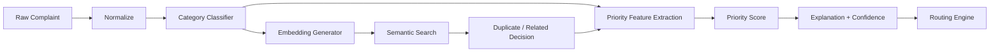

# AI Classification, Deduplication and Prioritization

## 0. PS framing

This document covers both problem statements as one pipeline:

- **Steps 1–2 below (normalization, category classification) = SMA03**, the intake/classification/routing capability.
- **Steps 3–5 (duplicate detection, priority scoring, explanation) = MSC02**, the core prioritization capability.

SMA03's classification output (category, subcategory, confidence) is not a separate feature — it is the direct input MSC02's priority engine consumes. There is one pipeline, one output object, one downstream consumer.

## 1. AI pipeline



## 2. Classification (SMA03 capability)

Minimum taxonomy for the demo:

- Academics
- Exams
- Hostel
- Infrastructure
- Fees/Finance
- Administration
- Library
- Transport
- Other

Each category can have subcategories.

Output:

```json
{
  "category": "HOSTEL",
  "subcategory": "WATER_SUPPLY",
  "confidence": 0.94,
  "evidence": ["hostel", "water", "block A"]
}
```

## 3. Duplicate detection (MSC02 capability)

Recommended hackathon implementation:

1. clean and normalize text;
2. generate sentence embeddings;
3. retrieve top-k similar active/archived complaints;
4. filter by useful metadata such as department/category/time window;
5. compare similarity;
6. apply business rules;
7. return `DUPLICATE`, `RELATED`, or `NEW`;
8. store the explanation and similarity evidence.

Do not claim "AI understands duplicates perfectly." Present it as a probabilistic recommendation with thresholds and human override.

## 4. Priority score (MSC02 core)

Start with a transparent weighted policy model.

Example:

```text
Priority =
  0.30 × Impact
+ 0.25 × Urgency
+ 0.20 × AffectedUsers
+ 0.15 × SLA_Risk
+ 0.10 × Recurrence
```

Normalize each component to 0–100.

The weights must be configurable by institution.

### Impact

Examples:

- safety risk;
- access to essential service;
- examination disruption;
- academic continuity;
- financial impact.

### Urgency

Examples:

- immediate;
- today;
- this week;
- routine.

### Affected users

Use reported/estimated affected count and cluster size.

### SLA risk

Increase as the deadline approaches.

### Recurrence

Increase when similar incidents repeatedly appear.

## 5. Explainability

Show staff:

> Priority 86/100 — High

Reasons:

- 120 students affected;
- exam deadline in 24 hours;
- category: examination;
- SLA due in 3 hours;
- 14 related complaints detected.

## 6. Confidence fallback

If classification confidence is below a configured threshold:

- do not silently route;
- place the case into a review queue;
- show top candidate categories;
- allow authorized staff to choose;
- log the correction for evaluation.

## 7. AI safety

AI must not:

- decide guilt;
- reject a grievance solely because of model output;
- expose private data unnecessarily;
- fabricate evidence;
- change a student's complaint text without retaining the original.
