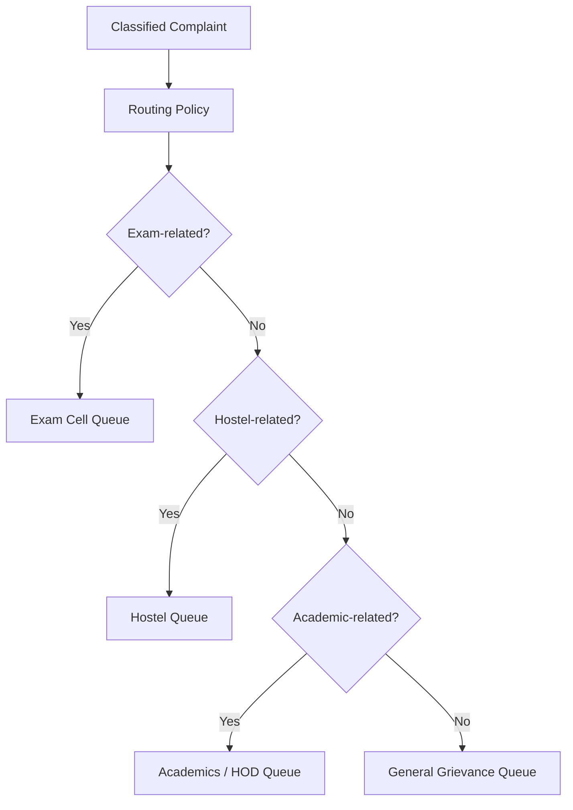
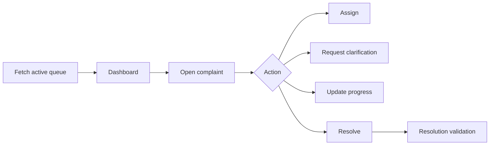

# Routing and Departmental Architecture

## 0. PS framing

Routing is the SMA03 capability ("classifies incoming documents and routes them to appropriate departments") applied at the end of the MSC02 pipeline rather than as a standalone step — the routing decision uses the category/department signal from classification plus the priority/cluster context from MSC02, so routing is informed by urgency and impact, not just raw category.

## 1. Routing model

Routing should be configuration-driven.



AI classification provides a recommendation. The routing policy validates it.

## 2. Department schemas

A practical implementation can use one database with separate logical schemas/tables:

```text
central
  complaints
  complaint_clusters
  priority_history

exam_cell
  queue_items
  actions

hostel
  queue_items
  actions

academics
  queue_items
  actions

audit
  events

archive
  closed_cases
```

For a small MVP, these can also be tables with a `department_id` column. Separate physical databases are not required.

## 3. Department workflow



## 4. Department-specific responsibilities

### Exam Cell

Typical cases:

- exam timetable;
- hall ticket;
- result discrepancy;
- examination process;
- eligibility;
- examination logistics.

### Hostel

Typical cases:

- water;
- electricity;
- room maintenance;
- sanitation;
- safety;
- food/service issues.

### Academics / HOD

Typical cases:

- academic process;
- faculty/course concerns;
- timetable conflicts;
- attendance-related process;
- academic approvals.

The actual mapping must be configurable to the institution.

## 5. Cross-department cases

A complaint may involve multiple departments.

Use a primary owner plus collaborators:

```text
Primary owner: Hostel
Collaborator: Maintenance
Escalation authority: Central Grievance Admin
```

Do not create duplicate tickets unnecessarily.
