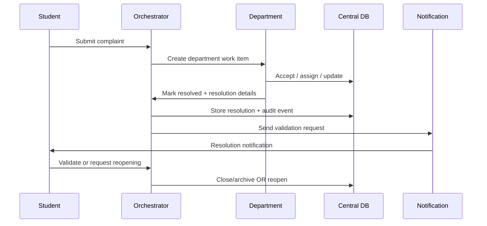

# Department Dashboard, Resolution and Back-Flow

## 1. Dashboard

Department dashboard should show:

- new complaints;
- high-priority complaints;
- SLA due soon;
- SLA breached;
- assigned to me;
- unassigned;
- recurring issue clusters;
- resolved today;
- reopen requests.

## 2. Complaint detail

Show:

- complaint ID;
- original student statement;
- category/subcategory;
- AI confidence;
- priority score and reasons;
- related complaint count;
- current owner;
- SLA deadline;
- status timeline;
- attachments subject to permission;
- previous actions;
- resolution field.

## 3. Resolution flow

## 4. Corrected back-flow

Do not implement:

> Delete from department schema → reset central priority → resolved.

Instead:

> Mark department work item resolved → remove from active queue projection → persist resolution centrally → append audit event → request student validation → close/archive after validation or policy timeout.

## 5. Student validation

Options:

- Accept resolution.
- Not resolved / reopen.
- Need clarification.

If the student does not respond, use a configurable policy. Do not silently claim satisfaction.

## 6. Reopening

A reopened case:

- gets a new event;
- preserves old resolution;
- returns to an active queue;
- recalculates SLA according to policy;
- notifies responsible authority.
