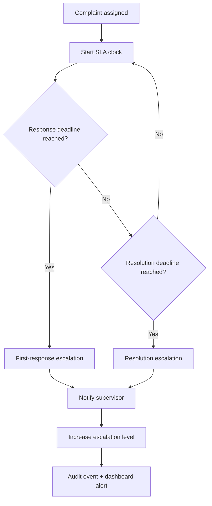

# SLA, Escalation and Reopening

## 1. Why SLA matters

Prioritization without accountability is incomplete. A high-priority complaint should not remain unattended indefinitely.

## 2. SLA lifecycle



## 3. Escalation levels

Make them configurable:

```text
Level 0 → Assigned staff
Level 1 → Department supervisor
Level 2 → Department head / HOD
Level 3 → Central grievance authority
```

The system should never hard-code titles that differ between institutions.

## 4. SLA states

- ON_TRACK
- DUE_SOON
- BREACHED
- ESCALATED
- PAUSED
- RESOLVED

## 5. Pause rules

Some cases may require student clarification. If policy allows pausing:

- record reason;
- record timestamp;
- notify student;
- exclude paused time only according to policy.

## 6. Reopen

A reopened complaint is not a new complaint by default. It keeps the original ID and creates a new lifecycle segment.

## 7. Automated actions

At SLA thresholds:

- dashboard alert;
- email/push notification;
- escalation;
- priority adjustment;
- analytics event.

Do not automatically punish staff or departments based solely on the system.
