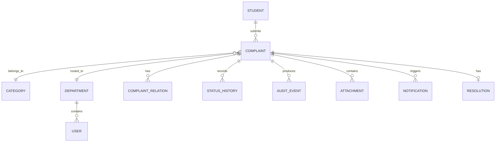

# Data Model

## 0. Canonical intake object (SMA03 → MSC02 join point)

Before a `complaints` row is created, every channel adapter (web/email/document) produces this in-memory/transient object:

```text
CanonicalComplaintInput
  source              # WEB | EMAIL | PDF | SCAN
  raw_content
  extracted_text
  attachments[]
  sender_identity      # resolved to student_id where possible
  timestamp
  detected_language
  extracted_entities    # optional, e.g. location, block, deadline mentions
```

This object is not persisted as its own table for the MVP — it's the input contract to complaint creation. `complaints.original_text` stores `extracted_text`, and `source` can be added as a column on `complaints` if channel-level analytics are wanted later.

## 1. Core entities



## 2. Complaint

Suggested fields:

```text
id
student_id
original_text
normalized_text
category
subcategory
classification_confidence
priority_score
priority_reasons
status
department_id
assigned_to
cluster_id
sla_policy_id
sla_due_at
created_at
updated_at
resolved_at
closed_at
```

## 3. Complaint relation

```text
source_complaint_id
target_complaint_id
relation_type
similarity_score
created_at
created_by
```

## 4. Status history

Never overwrite lifecycle history.

```text
complaint_id
from_status
to_status
actor_id
reason
created_at
```

## 5. Audit event

```text
id
event_type
actor_type
actor_id
entity_type
entity_id
payload
timestamp
correlation_id
```

## 6. Important indexes

- `complaints(status, department_id)`
- `complaints(sla_due_at)`
- `complaints(category, created_at)`
- vector index for semantic similarity
- `audit_event(entity_id, timestamp)`

## 7. Retention

Retention must be a policy/configuration decision. Archive instead of deleting unless a lawful retention policy requires deletion.
