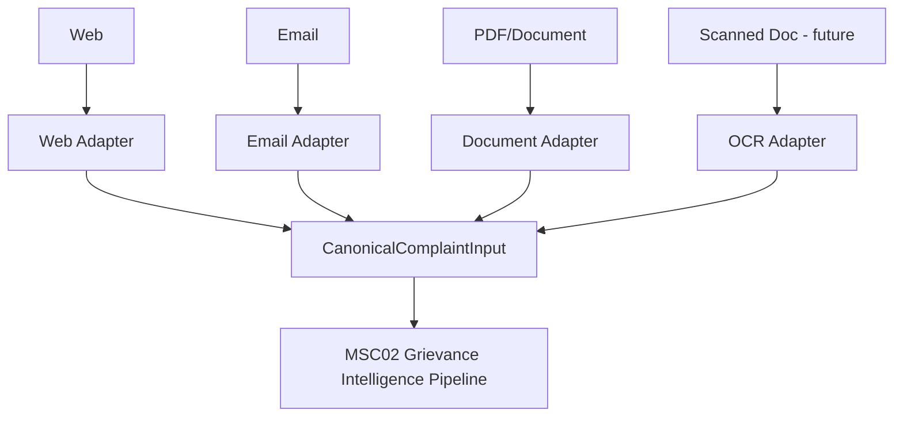
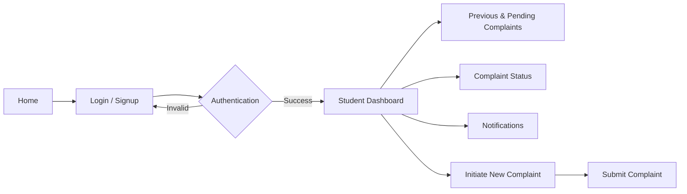
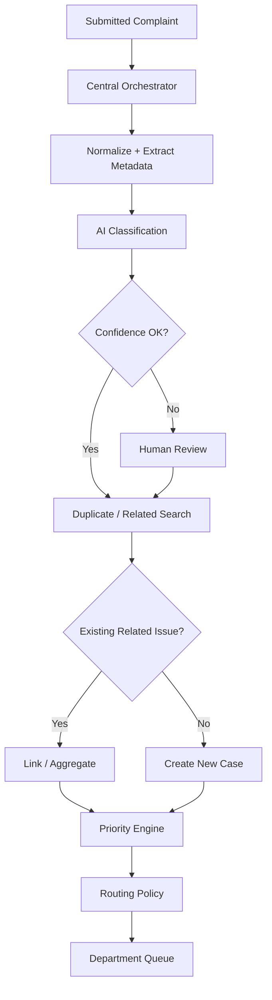
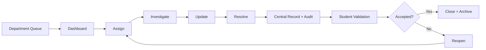
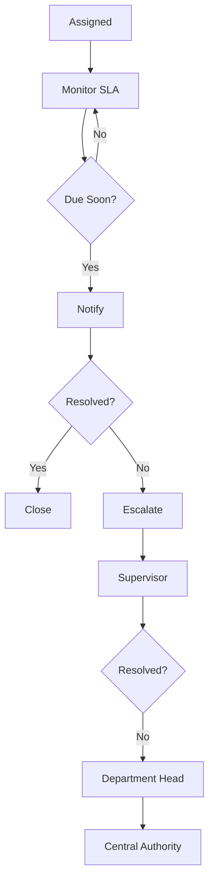
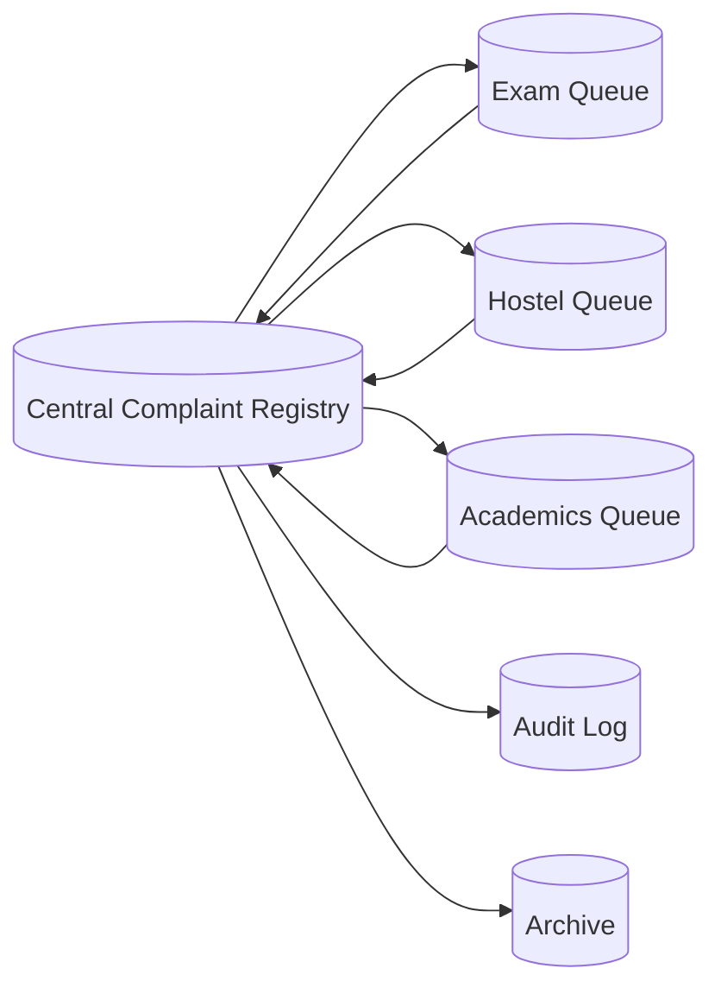

# Canonical Architecture and Flow Diagrams

## 0. Multi-channel intake (SMA03 → MSC02 join point)

This is the diagram that proves "one unified platform" rather than "two systems merged." Every channel produces the same canonical object; MSC02 never branches logic by source channel.

## 1. Student flow

## 2. Intelligence and orchestration

## 3. Department resolution

## 4. Escalation

## 5. Data architecture

## 6. Important diagram rule

Avoid diagrams that show:

- deletion as the final state;
- duplicate detection before classification;
- an unlabeled infinite feedback loop;
- departments owning the only copy of a complaint;
- AI directly changing institutional policy.

Every diagram should make ownership, state transition, and fallback behavior clear.
