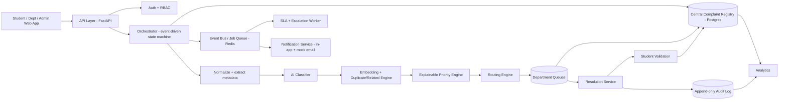

# Final Architecture — Grievance Intelligence & Orchestration Platform

Status: pre-implementation sign-off document, per Section 47 of the master prompt.
Base: your 23-file `docs/` package (already strong) + the corrections below.

## Amendment — PS alignment (MSC02 core / SMA03 integrated intake)

This architecture is now explicitly aligned to two problem statements as **one platform**:

- **MSC02 (core):** categorization, urgency/impact assessment, prioritization — this *is* the AI pipeline, duplicate engine, and priority engine described in §5 below.
- **SMA03 (integrated intake layer):** document/email classification and department routing — implemented as the multi-channel adapter layer (§0 addition below) that produces a `CanonicalComplaintInput`, which is the *only* thing that changes: everything downstream (§5 AI architecture, §8 state machine, §9 events) is completely unchanged regardless of which channel a complaint entered through.

See `docs/PS_TRACEABILITY_MATRIX.md` (capability-to-requirement mapping) and `docs/PS_COVERAGE_GAP_ANALYSIS.md` (honest FULLY/PARTIALLY/NOT COVERED status per requirement) — both now part of the docs set. The one architectural addition this requires: a thin **Intake Adapter Layer** (Web/Email/Document adapters) sitting in front of the Orchestrator in §1's diagram, normalizing all channels to one canonical object before anything else happens. Recommend: Web adapter live, Email adapter simulated (seeded payload through the same path), PDF live if time allows, OCR out of scope — do not overclaim live integrations you haven't built.

---

## 0. Verdict on the existing docs package

Your `docs/` folder is already in good shape — better than most hackathon docs I see. It already independently made three of the corrections the long master prompt insists on:

- Classify **before** duplicate detection (docs already do this — good).
- No hard delete; central registry retains history, department queues are projections (already correct).
- AI recommends, humans/policy decide (already correct, with confidence thresholds).

So I'm not rewriting from scratch. Below is what I'd **change, tighten, or push back on**, followed by the 16 final artifacts you asked for. Where I disagree with something in the docs or the long prompt, I say so explicitly (Section 46 asked me to challenge, not just agree).

### Things I'd push back on / change

1. **"Central Orchestrator" is doing too much conceptually.** As written it's a god-object that touches normalization, AI, dedup, priority, routing, SLA init, notifications, and archival. For a modular monolith this is fine as a *coordinating layer that emits/consumes events*, but if you implement it as one class/service that directly calls every other module synchronously, you'll get a tangled mess by day 2 of the hackathon. **Fix:** Orchestrator = a thin state-machine driver that reacts to events and calls one module at a time. Each module (AI, dedup, priority, routing) is independently callable and testable. This is a naming/discipline issue, not an architecture rewrite.

2. **pgvector is listed as "if available" — make it a hard MVP dependency, not optional.** Duplicate/related detection is your headline AI feature. A keyword-fallback duplicate detector will look weak in front of judges. Postgres + pgvector is one extension; there's no real reason to treat it as optional in 2026. Commit to it in Phase 2.

3. **The 5-factor priority formula (Impact/Urgency/AffectedUsers/SLA_Risk/Recurrence) is good, but "Impact" and "Urgency" are themselves unexplained black boxes** unless you define how they're computed. Don't let this become "the AI outputs impact=90" with no rationale. Define impact/urgency as **rule-based sub-scores** (e.g., category severity table + keyword signals like "exam tomorrow", "safety", "no access to X") so the *whole* priority chain is auditable, not just the top-level formula. This is the difference between "explainable" and "looks explainable."

4. **Cross-department routing (primary owner + collaborator) is under-specified everywhere it's mentioned.** Every doc says "use primary owner + collaborators" but none define what a collaborator can actually *do* (view only? comment? get notified? partially resolve?). For the MVP, I'd cut this down to: collaborator = read + comment only, primary owner = full control. Don't build collaborative editing/joint resolution for a hackathon — it's a rabbit hole.

5. **Don't build a real notification service (email/SMS) for the hackathon demo.** It's listed as MVP in some docs. In-app notifications + a mocked "notification event log" is enough to prove the concept and demo reliably without depending on SMTP/SMS providers failing live on stage. Promote email/SMS to "should-have," not "must-have."

6. **The 46-department-style configurability (arbitrary hierarchy, arbitrary escalation titles) is correctly designed on paper but is the single biggest scope risk.** A fully generic, config-driven department/hierarchy/SLA engine is real production software. For the hackathon: hard-code 3 departments (Exam Cell, Hostel, Academics/HOD) and 3 escalation levels in seed data, but make sure the **code path** reads from a `departments` / `escalation_policies` table rather than `if category == "hostel"` conditionals. That gets you the "it's configurable" credibility with judges without you having to build an admin UI to prove it.

7. **AI provider abstraction — good instinct, but for the hackathon use exactly one real provider + one deterministic mock**, not a pluggable multi-provider framework. Building a generic `AIProvider` interface with only one real implementation behind it is the right amount of abstraction; don't over-invest in "provider swapping" as a feature to demo.

8. **One thing the docs don't mention: rate limiting/anti-spam on complaint submission.** A grievance system is an obvious target for a student to spam-submit ("no water" x50 to game priority). You already cluster duplicates, which helps, but add a simple per-student submission rate limit (e.g., N complaints per hour) — it's a 10-line check with real credibility payoff for judges asking about abuse.

None of this contradicts your docs' direction — it's tightening, not redirecting.

---

## 1. Final architecture (component view)



Pattern: **modular monolith**, single Postgres instance, one background worker process (Redis/RQ or Celery), single deploy unit. Modules are separated by folder/package boundary only — this is what makes "can later become microservices" a true statement instead of a slide claim.

---

## 2. Final folder structure

```text
project/
├── apps/
│   ├── web/                  # Next.js: student / department / admin portals
│   └── api/                  # FastAPI backend
│       ├── auth/
│       ├── complaints/
│       ├── ai/
│       │   ├── classifier.py
│       │   ├── embeddings.py
│       │   ├── duplicate_engine.py
│       │   └── priority_engine.py
│       ├── routing/
│       ├── departments/
│       ├── sla/
│       ├── notifications/
│       ├── resolution/
│       ├── analytics/
│       ├── audit/
│       └── events/           # event definitions + dispatcher
├── workers/                  # SLA checker, notification sender, embedding jobs
├── db/
│   ├── migrations/
│   └── seeds/                # demo departments, categories, SLA policies, demo complaints
├── packages/
│   └── shared-types/         # TS types shared by web app, generated from API schema
├── tests/
├── docs/                     # your existing 23 files + this one
└── infra/                    # docker-compose, env templates
```

---

## 3. Final database architecture

Core tables (Postgres, single schema, `department_id` column pattern — not separate physical DBs):

```text
users(id, email, role, department_id, name, created_at)
departments(id, name, code, categories[], sla_policy_id, escalation_policy_id, active)
categories(id, name, parent_category_id)
students(id, user_id, roll_no, ...)

complaints(
  id, student_id, original_text, normalized_text,
  category, subcategory, classification_confidence,
  priority_score, priority_reasons JSONB,
  status, department_id, assigned_to,
  cluster_id, sla_policy_id, sla_due_at,
  created_at, updated_at, resolved_at, closed_at
)

complaint_clusters(id, category, subcategory, canonical_summary, affected_count, created_at)
complaint_relations(source_complaint_id, target_complaint_id, relation_type, similarity_score, created_by, created_at)
complaint_embeddings(complaint_id, embedding vector(384))   -- pgvector

status_history(complaint_id, from_status, to_status, actor_id, reason, created_at)
priority_history(complaint_id, old_score, new_score, reason, actor_id, created_at)
assignments(complaint_id, assigned_to, assigned_by, created_at)

sla_policies(id, department_id, response_minutes, resolution_minutes)
sla_events(complaint_id, event_type, level, created_at)
escalation_policies(id, department_id, levels JSONB)   -- [{level, role, notify}]

notifications(id, complaint_id, student_id, channel, payload, status, created_at)
attachments(id, complaint_id, url, mime_type, size, scanned, created_at)
resolutions(id, complaint_id, resolved_by, resolution_text, created_at)
audit_events(id, event_type, actor_type, actor_id, entity_type, entity_id, payload JSONB, correlation_id, created_at)
```

Indexes: `complaints(status, department_id)`, `complaints(sla_due_at)`, `complaints(category, created_at)`, ivfflat/hnsw vector index on `complaint_embeddings`, `audit_events(entity_id, created_at)`.

Retention: archive via a `closed_at`/`archived_at` flag, not a separate physical archive table for MVP — simpler, and analytics queries stay uniform.

---

## 4. Final API architecture

```http
# Student
POST   /api/v1/complaints
GET    /api/v1/complaints
GET    /api/v1/complaints/{id}
POST   /api/v1/complaints/{id}/validation
POST   /api/v1/complaints/{id}/reopen

# Department
GET    /api/v1/departments/{deptId}/queue
GET    /api/v1/complaints/{id}          # scoped by RBAC, same endpoint
POST   /api/v1/complaints/{id}/assign
POST   /api/v1/complaints/{id}/status
POST   /api/v1/complaints/{id}/resolve
POST   /api/v1/complaints/{id}/request-clarification

# Admin
GET    /api/v1/admin/analytics
GET    /api/v1/admin/escalations
PUT    /api/v1/admin/departments/{id}
PUT    /api/v1/admin/sla-policies/{id}
```

Rules: complaint creation is **async** — returns `{complaintId, status: "PROCESSING"}` immediately, classification/dedup/priority/routing happen in a background job, client polls or gets a websocket/push update. Every mutating endpoint requires an idempotency key. Authorization is derived server-side from the authenticated user's claims — department ID is never trusted from the request body.

---

## 5. Final AI architecture

```text
Raw text → Normalize → Category Classifier → Embedding → pgvector similarity search
                                                              ↓
                                            Duplicate/Related/New decision (rules + threshold)
                                                              ↓
                                   Rule-based Impact/Urgency/Recurrence sub-scores
                                                              ↓
                                        Weighted Priority Engine (configurable weights)
                                                              ↓
                                              Routing recommendation → Routing policy
```

- One real LLM call for classification (structured JSON output), one embedding call for similarity.
- `AIProvider` interface with exactly one live implementation + one deterministic mock (for offline demo safety).
- Confidence threshold (e.g. <0.6) → human review queue, never silent auto-route.
- Every AI decision persisted with model name, input, output, confidence, and any human override — this is what makes "AI evaluation" in Section 15 possible at all.

---

## 6. Final auth / RBAC architecture

- JWT-based session (email+password or OTP for the prototype; SSO is a future-roadmap item, don't build it now).
- Roles: `student`, `department_staff`, `department_head`, `central_admin`.
- Scope: `department_id` claim on staff/head roles; students scoped to `student_id = self`.
- Middleware resolves department scope from the token, not from query params — this single rule prevents the "hostel staff reading exam cell complaints" failure mode called out in the docs.

---

## 7. Final department hierarchy

Config-driven table, seeded (not hard-coded in application logic) with 3 departments for the hackathon:

```text
Exam Cell        → Level0 staff → Level1 supervisor → Level2 HOD-equivalent → Level3 central authority
Hostel           → same 4 levels
Academics/HOD    → same 4 levels
```

Escalation level count and titles come from `escalation_policies.levels JSONB`, so adding a 4th department or renaming "HOD" to "Registrar" is a data change, not a code change — this is the concrete proof point for "configurable, not hard-coded."

---

## 8. Final complaint state machine

```text
SUBMITTED → PROCESSING → CLASSIFIED → ROUTED → ASSIGNED → IN_PROGRESS
   → WAITING_FOR_STUDENT (optional) → RESOLVED → VALIDATION_PENDING
   → CLOSED → ARCHIVED
   (any active state) → ESCALATED (parallel flag, not a replacement state)
   VALIDATION_PENDING → REOPENED → back to ASSIGNED/IN_PROGRESS
```

Each transition table entry defines: allowed source states, allowed actor roles, required fields, audit event emitted, notification triggered. Illegal transitions are rejected at the service layer, not just the UI.

---

## 9. Final event architecture

```text
complaint.created
complaint.classified
complaint.duplicate_detected
complaint.cluster_updated
complaint.prioritized
complaint.routed
complaint.assigned
complaint.sla_due_soon
complaint.escalated
complaint.resolved
complaint.validation_requested
complaint.reopened
complaint.archived
```

All events carry a `correlation_id` tying back to the originating complaint/request, written to `audit_events`. Worker processes subscribe to relevant events (SLA worker, notification worker) rather than being called synchronously by the orchestrator.

---

## 10. Final frontend architecture

```text
/login, /dashboard, /complaints, /complaints/new, /complaints/:id, /notifications   (student)
/department/dashboard, /department/queue, /department/complaints/:id               (staff)
/admin/dashboard, /admin/departments, /admin/sla, /admin/analytics, /admin/audit    (admin)
```

Next.js + TypeScript + Tailwind. Shared types generated from the API's OpenAPI schema so frontend/backend don't drift. No client-side department filtering — the API returns only what the authenticated user is scoped to see.

---

## 11. Final backend architecture

FastAPI, modular monolith per the folder structure in §2. Background jobs (classification, embedding, dedup, SLA checks, notifications) run via Redis + RQ (simpler than Celery for a hackathon timeline). Each module exposes a plain Python service function callable both from the API layer and from a job — no logic embedded directly in route handlers.

---

## 12. Final deployment architecture

```text
Frontend  → Vercel
Backend   → Single container (Render/Railway/Fly.io) or docker-compose on a VM
Database  → Managed Postgres with pgvector (Supabase/Neon/RDS)
Redis     → Managed Redis (Upstash) or same VM
Workers   → Same container, separate process
```

Single environment for the hackathon (no staging/prod split needed); document how it would split for real deployment (separate worker fleet, managed Postgres with read replica, CDN for attachments) as a "production evolution" note rather than building it now.

---

## 13. Final security model

- HTTPS everywhere, JWT with short expiry + refresh, RBAC + department scope enforced server-side.
- Input validation on every endpoint (pydantic schemas), file type/size validation on attachments, virus-scan hook stubbed (real scanning is future-roadmap unless a free API is trivially available).
- Rate limiting on complaint submission per student (abuse control called out in §0.8).
- Secrets via environment variables only, never committed.
- Structured logs with no complaint text/PII in log lines — only IDs and correlation IDs.
- Minimize PII sent to the LLM provider: send normalized complaint text + category context, not student name/roll number.

---

## 14. Final testing strategy

- Unit tests: priority engine (given fixed inputs, verify deterministic score + reasons), state machine (illegal transitions rejected), RBAC scoping.
- Integration tests: the 6 scenarios already defined in your `15_TESTING_AND_EVALUATION.md` (new complaint, duplicate, low-confidence, SLA breach, resolution, rejection/reopen) — these are good, keep them as-is.
- A small labeled evaluation set (~30–50 hand-labeled complaint pairs) for duplicate-detection precision/recall, and ~30 labeled complaints for classification accuracy — small enough to build in a day, large enough to give judges a real number instead of a guess.
- Security tests: IDOR check (department A staff hitting department B's complaint ID), oversized upload, unauthenticated access to any endpoint.

---

## 15. Final MVP scope

**Must-have (matches your `16_MVP_ROADMAP.md`, unchanged):** auth, student dashboard/submission, AI classification, pgvector-based duplicate/related detection, explainable priority, routing to 3 departments, department dashboard, assignment, SLA timer + escalation, resolution, student validation, reopen, audit timeline.

**Cut from "must-have" to "should-have" (my change vs. some phrasing in the docs):** real email/SMS notifications (use in-app + logged events only), cross-department collaborator workflows beyond read+comment, admin UI for editing SLA/routing policy (seed it via migration instead).

**Explicitly out of scope:** microservices, custom model training, blockchain, native mobile app, multilingual input, voice input.

---

## 16. Final demo scenario

Unchanged from your `17_DEMO_SCRIPT.md` — it's well-constructed and hits the right beats (intake → intelligence → duplicate clustering → routing → SLA/accountability → resolution → validation → analytics). One addition: open the demo by explicitly stating the abuse/rate-limit control and the AI confidence fallback path once, briefly — judges who've seen a few AI hackathon projects will probe for exactly these two gaps, and pre-empting them lands better than answering reactively in Q&A.

---

## What I'd need from you to move to Phase 1 (implementation)

1. Confirm the 3-department MVP scope (Exam Cell / Hostel / Academics-HOD) is right, or if you want a 4th for the demo.
2. Confirm the AI provider (Groq, given your other projects already use it, is a reasonable default — cheap, fast, good enough for classification JSON).
3. Confirm you're okay treating email/SMS notifications as "should-have" (in-app only for MVP) — this is the one place I'm cutting scope from what some of your docs list as must-have, and I want your sign-off before we build against it.

Once confirmed, next step is Phase 1 from `14_TECH_STACK_AND_IMPLEMENTATION.md`: repo scaffold + DB migrations + auth — I won't generate the full codebase in one shot, per your own instruction in the master prompt.
