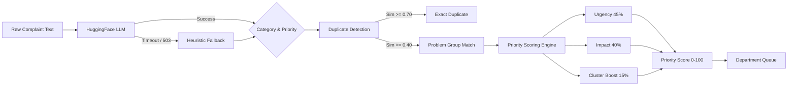

# AI Classification, Deduplication, and Prioritization

The grievance intelligence pipeline transforms unstructured text into prioritized, routed, and aggregated operational workloads.

## 1. Pipeline Flow

## 2. Classification & Routing

**File:** `services/llm.py` and `pipeline/classifier.py`

When a complaint is submitted, it is sent to a HuggingFace Inference API model (e.g., Llama 3 or Mistral).
- The LLM extracts: `department`, `category`.
- **Classification Source Tracking:** The `classification_source` column records whether the routing was determined by "AI" or "RULE".
- **Resilience:** The call has an 8-second hard timeout. If the model returns a 503 (cold start) or times out, the system instantly catches the error and falls back to a regex-based heuristic classifier (`pipeline/classifier.py`) which sets `classification_source="RULE"`.

## 3. Semantic Embeddings

**File:** `services/embedding_service.py`

- The system uses `sentence-transformers/all-MiniLM-L6-v2` to generate 384-dimensional embeddings of complaint texts.
- Embeddings are stored in PostgreSQL using the `pgvector` extension, with an HNSW index configured for fast nearest-neighbor (NN) similarity searches.
- This allows real semantic search (not just lexical keyword matching) for background deduplication and emerging cluster detection.

## 4. Duplicate & Group Detection

**File:** `pipeline/duplicate_detector.py` and `services/problem_grouping.py`

To prevent staff from resolving the same broken pipe 100 times, GIOP automatically groups similar complaints.

- **Fast Path (Lexical):** During ingestion, a fast synchronous check uses Jaccard similarity.
- **Exact Duplicate (`>= 0.70`):** The new complaint is marked as a duplicate of an existing one. It does not appear in the department's active queue.
- **Problem Group (`>= 0.40`):** The new complaint is linked to an overarching `ProblemGroup`.

## 5. Multi-Signal Priority Engine

**File:** `pipeline/priority.py`

GIOP uses an explainable multi-signal engine to calculate a priority score (0-100), rather than relying on a black-box LLM output.

- **Safety Risk (30 points):** Triggers on keywords like "harassment", "medical", "fire".
- **Urgency (25 points):** Triggers on "deadline", "emergency", "immediate". (12 points for service disruption like "water", "electricity").
- **Affected Users (up to 20 points):** Scales based on how many students have reported the issue (e.g., 50+ students = 20 points).
- **SLA Risk (15 points):** Boosts priority if the deadline is approaching in < 6 hours.
- **Recurrence (10 points):** Boosts priority if the problem has been reported multiple times.

The final score maps to: Low (<20), Normal (<40), High (<70), Urgent (70+). The engine outputs a structured `priority_reasons` array (e.g., `"63 students affected (+20)"`) so staff understand exactly *why* a complaint is prioritized.
